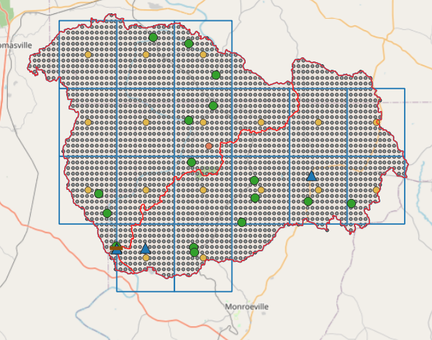

# Weather Extractor

**Version 2.4.1**

Weather Extractor is a QGIS plugin for accessing hydroclimatic data from multiple sources in a single interface. It brings together gridded weather data from NOAA’s AORC and ERA5-Land, observations from USGS, EPA, NOAA and Brazil’s ANA, and satellite-based evapotranspiration estimates from OpenET and MODIS.

Define your area of interest and period, explore available data, and download the selected datasets directly within QGIS. For station-based observations, check data availability and preview monitoring locations on the map before downloading. Outputs include CSV time series, GeoPackage station layers and optional SWAT+ weather files.



*Figure 1. Data sources within the same area of interest: AORC grid cells (~800 m, grey), ERA5-Land grid cells (~9 km, blue squares with yellow centres), and USGS monitoring stations (triangles for water quantity; green circles for water quality).*

## Installation

In QGIS, open **Plugins > Manage and Install Plugins**, search for **Weather Extractor**, and click **Install Plugin**.

Alternatively, download `Weather_Extractor-2.4.1.zip` from [Releases](https://github.com/ECRIPPEL/weather-extractor/releases) and install it through **Plugins > Manage and Install Plugins > Install from ZIP**.

### NOAA AORC dependencies

On first use of NOAA AORC, the plugin installs the required Python packages into your QGIS profile. This usually takes about a minute and requires access to PyPI.

For computers that cannot access PyPI, use the `-win-full.zip` release. This package includes the AORC dependencies for **Windows x64 with Python 3.12**, avoiding package downloads on first use. An internet connection is still required to download the hydroclimatic data.

### Google Earth Engine

ERA5-Land and the Remote Sensing tab require:

- The [Google Earth Engine plugin](https://plugins.qgis.org/plugins/ee_plugin/) for QGIS.
- A Google Cloud project [registered for Earth Engine](https://code.earthengine.google.com/register).

If a requirement is missing, the plugin identifies it when you click **Run**.

## Workflow

Start in **Setup** to define your area of interest and output settings. Then choose a data tab, select the period and datasets, and click its **Run** button. Use **Parallel processing** to configure concurrent tasks.

### 1. Setup

Define the area of interest using a polygon file, an existing project layer, a shape drawn on the map, or manually entered bounds.

For a polygon layer containing multiple watersheds or sub-basins, all features are included by default. To process only specific sub-basins, select one or more polygon features in QGIS and enable **Use only polygons selected on the map**. The chosen area is used consistently for previews, availability checks and downloads.

Choose the output folder, the coordinate reference system (CRS) for output layers, and the timezone. Timezone settings use local standard time, without daylight saving time. An optional elevation raster supplies elevations for gridded extraction points.


*Figure 2. Setup options for the area of interest, output folder, timezone and parallel processing.*

### 2. Gridded Data

Choose between two datasets:

| Dataset | Coverage | Spatial resolution | Record begins | Access |
| --- | --- | --- | --- | --- |
| NOAA AORC | Contiguous United States | ~800 m | 1979 | Direct download |
| ERA5-Land | Global land areas | ~9 km | 1950 | Google Earth Engine |

Both provide precipitation, temperature, solar radiation, humidity and wind from hourly data. The plugin exports daily and/or hourly time series and calculates FAO-56 reference evapotranspiration. ERA5-Land also provides evaporation, runoff and soil moisture.

Click **Preview availability** to display the exact station locations for the selected grid layout, along with the selected date range, variables and source coverage limits. The preview reads grid metadata only and does not download weather data. AORC coverage is limited to the contiguous United States and contributing areas; ERA5-Land is land-only, so some grid cells may have no values.

Choose how to distribute extraction points:

- **Original grid:** one point per dataset grid cell.
- **Grid blocks:** group cells into blocks of a chosen size.
- **Rain gauge locations:** extract at gauge locations identified in the USGS Data and HidroWeb Data tabs to compare gridded and observed rainfall.
- **AOI centroid:** extract from a single cell at the centre of the area of interest.


*Figure 3. Dataset selection in the Gridded Data tab.*


*Figure 4. ERA5-Land extraction on its original grid, with additional options for evaporation, runoff and soil moisture.*

### 3. USGS Data

Access observations from several monitoring networks:

- **USGS:** streamflow, gage height, groundwater, precipitation and water quality, including sensor time series and discrete samples.
- **Water Quality Portal:** water quality samples from participating agencies.
- **NOAA:** daily and hourly rain gauge observations from GHCN-Daily and GHCNh.

Click **Check available data** to query station metadata for the selected area and period. The table shows station counts by dataset, and the map displays their locations.

Uncheck unwanted datasets or keep only stations selected on the map, then click **Run**. Stations that return no data are removed from the map. An optional free [USGS API key](https://api.waterdata.usgs.gov/signup/) can speed up downloads.


*Figure 5. Available datasets and monitoring locations in the USGS Data tab.*

### 4. HidroWeb Data

Download daily streamflow, water level and rainfall observations from Brazil’s national monitoring network, managed by ANA.

Follow the same workflow as in the USGS Data tab: check availability, select stations and download the observations. Each time-series file contains dates and values; `hidroweb_index.csv` stores the station metadata.

Downloads use ANA’s public service, at approximately one series per second, or HidroWebService when ANA credentials are provided. The plugin does not save your password.

### 5. Remote Sensing

Download monthly actual evapotranspiration estimates averaged over your area of interest through Google Earth Engine:

| Dataset | Coverage | Spatial resolution | Record begins |
| --- | --- | --- | --- |
| OpenET | Contiguous United States | 30 m | 2016 |
| MODIS | Global | 500 m | 2000 |

These series can support evapotranspiration comparisons and watershed water-balance assessments.

## Outputs

Results are saved in the selected output folder:

| Data | Files or subfolder |
| --- | --- |
| Gridded weather | `<station>_daily.csv` and/or `<station>_hourly.csv` |
| Optional SWAT+ weather files | `swatplus_weather/` |
| USGS, Water Quality Portal and NOAA observations | `usgs_water_data/` |
| ANA observations | `hidroweb_data/` |
| Remote sensing evapotranspiration | `evapotranspiration/` |

Supporting outputs include GeoPackage station layers, a `README.txt` describing settings, units and conventions, and a `warnings.txt` when warnings occur.

Observed daily series include every day in the requested period, using `-99` for missing values. Output layers load automatically into a QGIS group named after the output folder. The `site_id` field links station layers to their time-series tables.

## Compatibility

- **QGIS 3.40 or later**, tested on Windows.
- Internet access is required to retrieve data.
- ERA5-Land and remote sensing downloads require Google Earth Engine.
- The bundled `-win-full.zip` package requires Windows x64 and Python 3.12.
- Geographic coverage varies by dataset; see the workflow sections above.

## Citation

If you use Weather Extractor, please cite:

> Weather Extractor contributors (2026). *Weather Extractor* (version 2.4.1) [QGIS plugin]. https://github.com/ECRIPPEL/weather-extractor

Please also cite the datasets and methods used in your work:

- **NOAA AORC:** Fall, G., et al. (2023). The Office of Water Prediction's Analysis of Record for Calibration, version 1.1. *JAWRA, 59*(6), 1246–1272. https://doi.org/10.1111/1752-1688.13143
- **ERA5-Land:** Muñoz Sabater, J. (2019). ERA5-Land hourly data from 1950 to present. Copernicus Climate Change Service (C3S) Climate Data Store. https://doi.org/10.24381/cds.e2161bac; and Muñoz-Sabater, J., et al. (2021). *Earth System Science Data, 13*, 4349–4383. https://doi.org/10.5194/essd-13-4349-2021
- **Reference evapotranspiration:** Allen, R.G., Pereira, L.S., Raes, D. & Smith, M. (1998). *Crop evapotranspiration.* FAO Irrigation and Drainage Paper 56. FAO, Rome.
- **USGS:** U.S. Geological Survey. Water Data for the Nation. https://waterdata.usgs.gov/
- **Water Quality Portal:** National Water Quality Monitoring Council. https://doi.org/10.5066/P9QRKUVJ
- **GHCN:** Menne, M.J., et al. (2012). *Journal of Atmospheric and Oceanic Technology, 29*, 897–910. https://doi.org/10.1175/JTECH-D-11-00103.1; and Menne, M.J., et al. (2023). GHCNh. NOAA NCEI. https://doi.org/10.25921/jp3d-3v19
- **HidroWeb:** Agência Nacional de Águas e Saneamento Básico (ANA). https://www.snirh.gov.br/hidroweb/
- **OpenET:** Melton, F.S., et al. (2022). *JAWRA, 58*(6), 971–994. https://doi.org/10.1111/1752-1688.12956
- **MODIS:** Running, S., et al. (2021). MOD16A2GF v061. NASA LP DAAC. https://doi.org/10.5067/MODIS/MOD16A2GF.061

ERA5-Land outputs must include the following attribution: “Generated using Copernicus Climate Change Service information [year]”.

Outputs are derived data. Weather Extractor is not affiliated with or endorsed by NOAA, ECMWF, USGS, EPA, ANA, OpenET, NASA or Google.

## Development

### Dependencies

`weather_extractor/requirements.txt` contains the pinned AORC dependencies used by both the first-use installer and the vendor builder.

The plugin relies on the QGIS environment for NumPy, pandas, Shapely, requests, tzdata and GDAL, as well as the QGIS and PyQt bindings.

### Build

From the repository root, run:

python scripts/build_zip.py

This creates `dist/Weather_Extractor-<version>.zip` without compiled files, as required by the QGIS plugin repository.

Use `--full` to also create a package containing the AORC dependencies for Windows x64 and Python 3.12.

### Tests

Run the offline tests using the Python environment supplied with QGIS. Adjust the path to match your installation:

```powershell
& 'C:\Program Files\QGIS 3.40.x\bin\python-qgis-ltr.bat' -m unittest discover -s tests -t . -v
```

## License

MIT. See [LICENSE](LICENSE).
