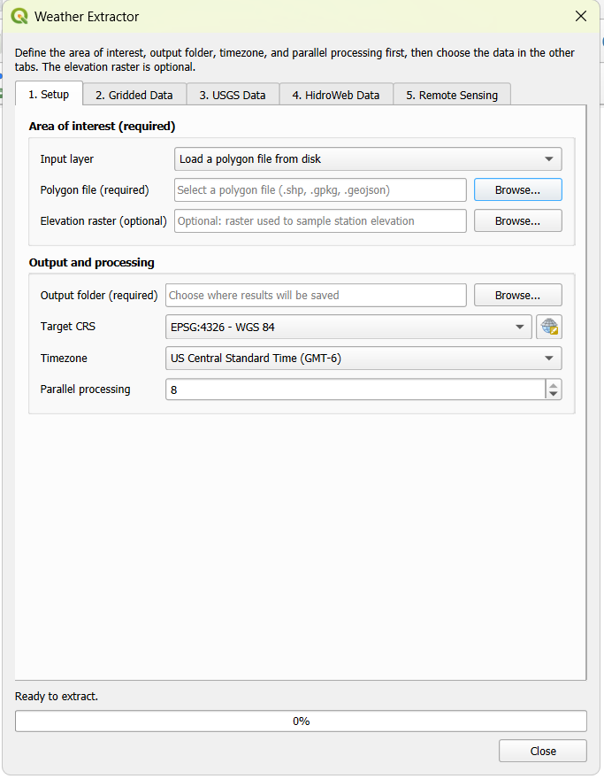
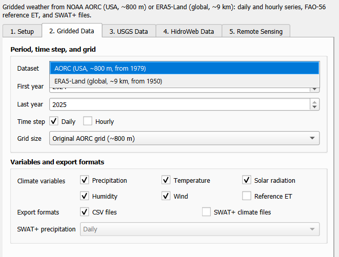
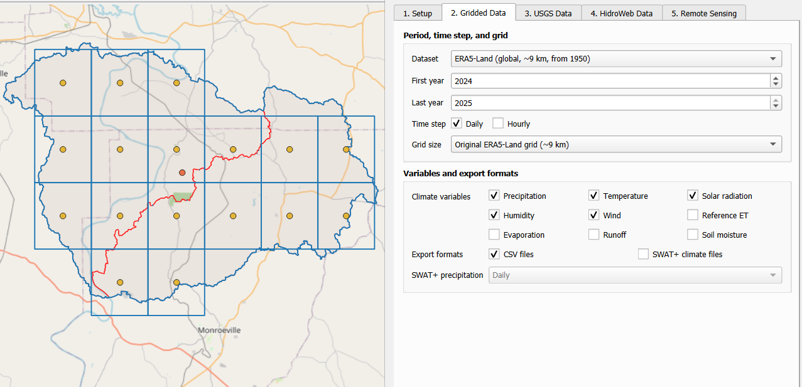
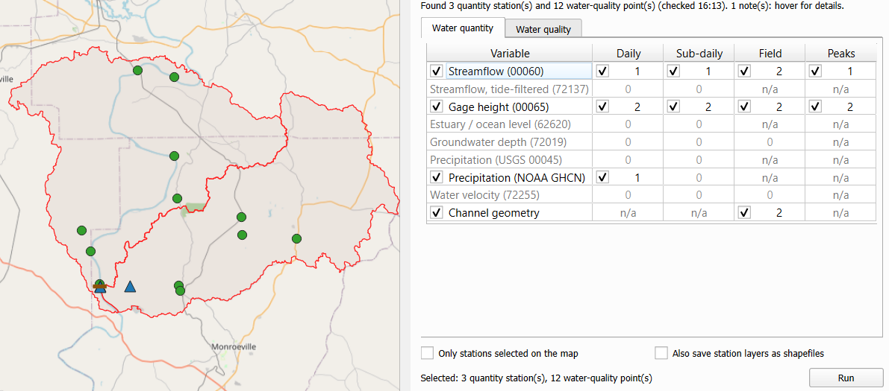

# Weather Extractor

**Version 2.4.1**

Weather Extractor is a QGIS plugin that downloads hydroclimatic data for an area of interest: gridded weather (NOAA's AORC dataset and ERA5-Land), observed data from USGS, EPA, NOAA and ANA, and evapotranspiration from OpenET and MODIS. Before downloading, each tab checks what exists in the area and period and previews the stations on the map. Outputs are CSV tables, GeoPackage station layers and optional SWAT+ climate files.


*Fig. 01 - One area of interest with the stations of each source: AORC cells (~800 m, grey), ERA5-Land cells (~9 km, blue squares with yellow centres) and USGS stations (triangles: water quantity; green circles: water quality).*

## Workflow

Define the area of interest in tab 1, then download from any data tab; each one has its own *Run* button. Every tab runs its tasks in parallel, as set in *Parallel processing*.

### 1. Setup

Load the area of interest from a polygon file or a project layer, draw it on the map or type its bounds. Choose the output folder, the CRS of the output layers and the timezone (local standard time, without daylight saving time). An elevation raster is optional and gives the elevation of the gridded stations.



*Fig. 02 - Setup: area of interest, output folder, timezone and parallel processing.*

### 2. Gridded Data

Choose the dataset: NOAA AORC (contiguous United States, ~800 m, from 1979) or ERA5-Land (global land, ~9 km, from 1950, through Google Earth Engine). Both give hourly precipitation, temperature, solar radiation, humidity and wind, plus FAO-56 reference ET, as daily and/or hourly series; ERA5-Land also gives evaporation, runoff and soil moisture. Stations follow the original grid, blocks of a chosen size, the rain gauges checked in tabs 3 and 4 (to compare gridded and observed rainfall) or a single cell at the AOI centroid.



*Fig. 03 - Gridded Data: the dataset selector.*



*Fig. 04 - ERA5-Land on its original grid: one station per ~9 km cell, with evaporation, runoff and soil moisture available.*

### 3. USGS Data

USGS streamflow, gage height, groundwater, precipitation and water quality (sensor series and samples), Water Quality Portal samples of other agencies, and NOAA rain gauges (GHCN-Daily and hourly GHCNh). *Check available data* reads only the metadata: the table counts the stations of each dataset in the area and period, and the map previews them. Uncheck what you do not need, or keep only the stations selected on the map, and press *Run*. Stations that return no data are removed from the map. A free [USGS API key](https://api.waterdata.usgs.gov/signup/) makes the downloads faster.



*Fig. 05 - USGS Data: the datasets available in the area, with their stations on the map.*

### 4. HidroWeb Data

Daily discharge, water level and rainfall of the Brazilian national network (ANA), with the same steps as tab 3. Each series file holds only the date and the value; `hidroweb_index.csv` holds the station details. Downloads use the public ANA service (about one series per second), or HidroWebService when you type your ANA login; the password is not saved.

### 5. Remote Sensing

Monthly actual ET from OpenET (CONUS, 30 m, from 2016) and MODIS (global, 500 m, from 2000), averaged over the area of interest through Google Earth Engine, for example to close a water balance.

## Outputs

Each tab writes to the output folder: gridded station series (`<station>_daily.csv`, `<station>_hourly.csv`, optional `swatplus_weather/`), `usgs_water_data/`, `hidroweb_data/` and `evapotranspiration/`. Each run also writes a GeoPackage with its stations, a `README.txt` with its settings, units and conventions, and a `warnings.txt` when needed. Observed daily series list every day of the period, with -99 where there is no value. The layers load into QGIS in a group named after the output folder, and the `site_id` column links layers and tables.

## Installation

In QGIS, open *Plugins > Manage and Install Plugins*, search for **Weather Extractor** and install it. You can also download `Weather_Extractor-2.4.1.zip` from [Releases](https://github.com/ECRIPPEL/weather-extractor/releases) and use *Install from ZIP*.

The first time you choose NOAA AORC, Weather Extractor installs its pinned dataset dependencies (xarray, zarr and helpers) with pip into your QGIS profile; this takes about a minute and happens once, and requires internet access to PyPI. NumPy, pandas, Shapely, requests, tzdata, and GDAL are provided by QGIS to keep the plugin small and compatible with QGIS's Python environment. QGIS, PyQt, and GDAL bindings therefore remain host requirements.

If the QGIS computer will be offline, download the `-win-full.zip` release while online and install it with *Install from ZIP*. It includes the pinned dependencies needed to use NOAA AORC on Windows x64 and Python 3.12, so Weather Extractor can use the dataset without downloading packages at first run. The regular plugin ZIP is smaller and downloads those dependencies from PyPI on first AORC use.

ERA5-Land and the Remote Sensing tab need the [Google Earth Engine plugin](https://plugins.qgis.org/plugins/ee_plugin/) and a Cloud project [registered for Earth Engine](https://code.earthengine.google.com/register). If a step is missing, *Run* lists it.

## Compatibility

- QGIS 3.40 or later (tested on Windows).
- AORC, USGS and EPA data cover the United States, HidroWeb covers Brazil, and ERA5-Land and MODIS are global.
- Internet access is required; ERA5-Land and the Remote Sensing tab also require Google Earth Engine.

## Citation

If you use Weather Extractor, please cite:

> Weather Extractor contributors (2026). *Weather Extractor* (version 2.4.1) [QGIS plugin]. https://github.com/ECRIPPEL/weather-extractor

Please also cite the data you download:

- NOAA AORC: Fall, G., et al. (2023). The Office of Water Prediction's Analysis of Record for Calibration, version 1.1. *JAWRA, 59*(6), 1246–1272. https://doi.org/10.1111/1752-1688.13143
- ERA5-Land: Muñoz Sabater, J. (2019). ERA5-Land hourly data from 1950 to present. Copernicus Climate Change Service (C3S) Climate Data Store. https://doi.org/10.24381/cds.e2161bac; and Muñoz-Sabater, J., et al. (2021). *Earth System Science Data, 13*, 4349–4383. https://doi.org/10.5194/essd-13-4349-2021
- Reference ET: Allen, R.G., Pereira, L.S., Raes, D. & Smith, M. (1998). *Crop evapotranspiration.* FAO Irrigation and Drainage Paper 56. FAO, Rome.
- USGS: U.S. Geological Survey. Water Data for the Nation. https://waterdata.usgs.gov/
- Water Quality Portal: National Water Quality Monitoring Council. https://doi.org/10.5066/P9QRKUVJ
- GHCN: Menne, M.J., et al. (2012). *Journal of Atmospheric and Oceanic Technology, 29*, 897–910. https://doi.org/10.1175/JTECH-D-11-00103.1; and Menne, M.J., et al. (2023). GHCNh. NOAA NCEI. https://doi.org/10.25921/jp3d-3v19
- HidroWeb: Agência Nacional de Águas e Saneamento Básico (ANA). https://www.snirh.gov.br/hidroweb/
- OpenET: Melton, F.S., et al. (2022). *JAWRA, 58*(6), 971–994. https://doi.org/10.1111/1752-1688.12956
- MODIS: Running, S., et al. (2021). MOD16A2GF v061. NASA LP DAAC. https://doi.org/10.5067/MODIS/MOD16A2GF.061

ERA5-Land outputs must state "Generated using Copernicus Climate Change Service information [year]". Outputs are derived data; the plugin is not affiliated with or endorsed by NOAA, ECMWF, USGS, EPA, ANA, OpenET, NASA or Google.

## Build

From the repository root, `python scripts/build_zip.py` writes `dist/Weather_Extractor-<version>.zip`, without compiled files, as the QGIS plugin repository requires. `weather_extractor/requirements.txt` is the single pinned list used by both the first-use installer and the vendor builder. `--vendor` downloads Weather Extractor's NOAA AORC dependencies into `weather_extractor/vendor/` (not kept in git), which the tests use, and `--full` also writes a Windows x64/Python 3.12 ZIP that bundles them for offline installation. Offline tests:

```powershell
& 'C:\Program Files\QGIS 3.40.x\bin\python-qgis-ltr.bat' -m unittest discover -s tests -t . -v
```

## License

MIT. See [LICENSE](LICENSE).
